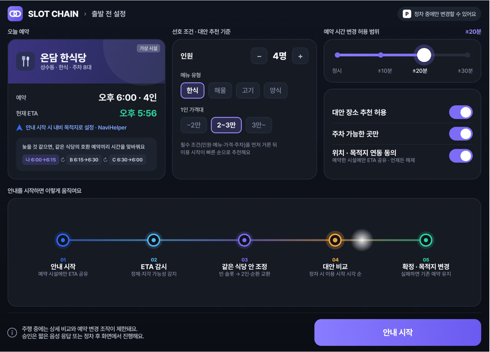
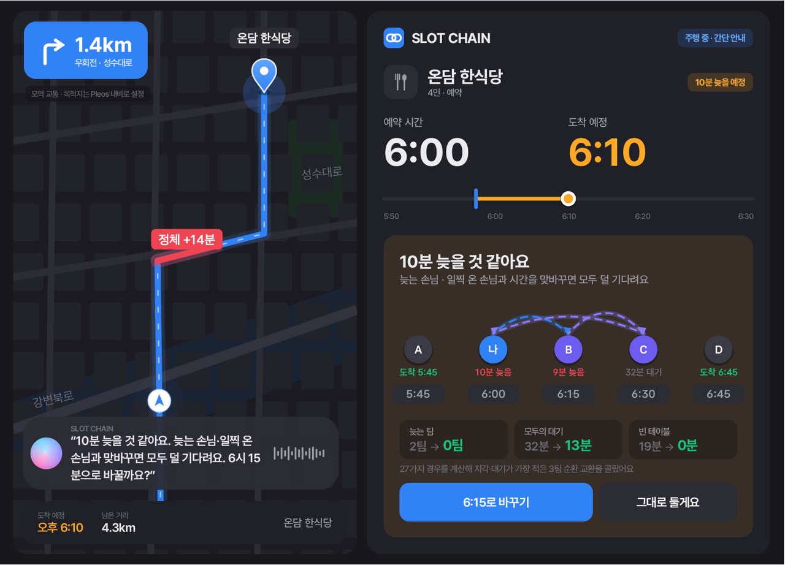
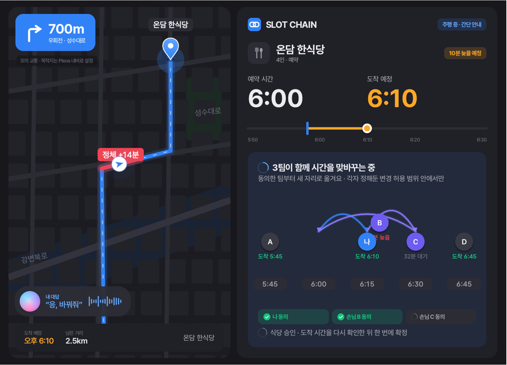
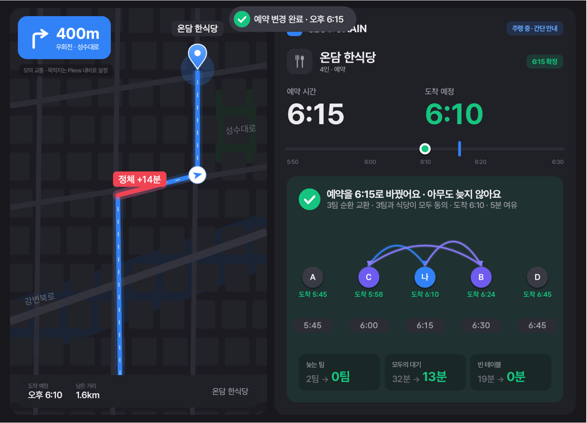
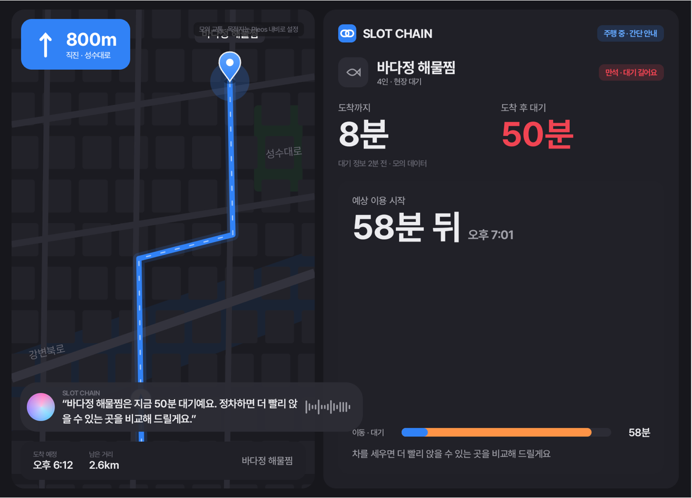
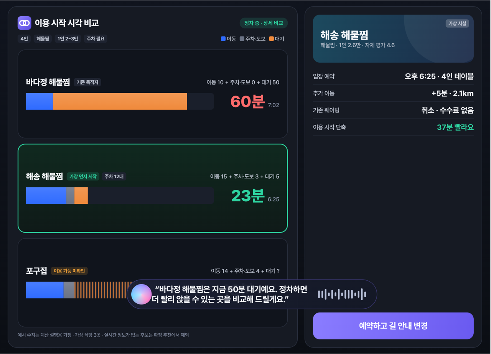
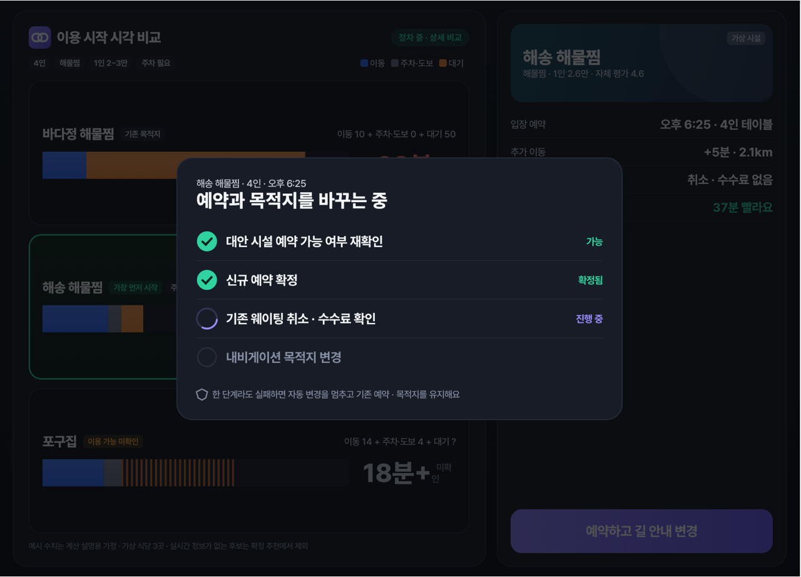
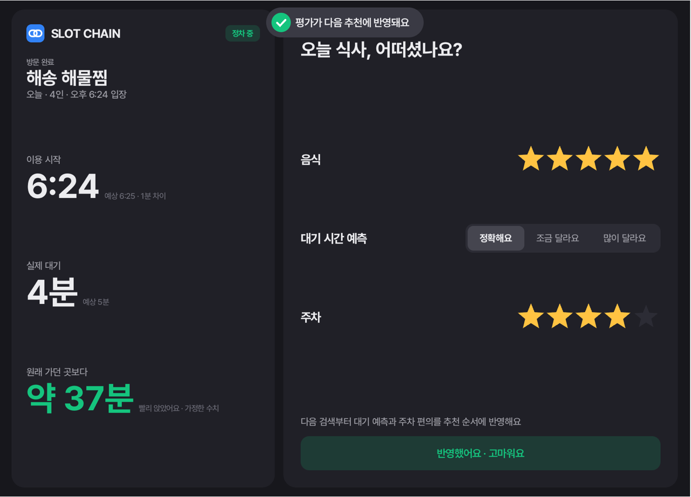

# SLOT CHAIN

차량 도착 예정 시간(ETA)과 시설 이용 가능 시간을 연결해 **예약 조정 · 대안 장소 추천 · 목적지 변경**을 지원하는 Pleos Connect(Android Automotive) 차량용 예약 앱입니다.

| 출발 전 설정 | 장면 A · 지각 예상 | 장면 A · 순환 교환 동의 | 장면 A · 확정 |
|---|---|---|---|
|  |  |  |  |
| **장면 B · 만석 · 긴 대기** | **이용 시작 시각 비교** | **예약·목적지 변경 4단계** | **장면 D · 방문 후 평가** |
|  |  |  |  |

## 구현된 것

- **예약 조정 엔진** (`Domain.kt`): 같은 식당 예약들이 도착 예정을 공유한다는 전제에서, 빈 슬롯 이동·2인 교환·여러 팀 순환 교환을 **모두 나열**하고 각 배치의 **지각(테이블이 비는 시간)과 대기**를 계산해 가장 적은 배치를 고릅니다. 제약: 각 팀이 동의한 앞당김·늦춤 범위 안, 원래 제시간이던 팀을 늦게 만들지 않음, 내 새 시간은 내 도착 이후. 시연 데이터(나 6:10 도착·B 9분 지각·C 32분 일찍 도착)에서는 `나 6:00→6:15 · B 6:15→6:30 · C 6:30→6:00` 순환으로 **늦는 팀 2→0, 모두의 대기 32→13분, 빈 테이블 19→0분**이 됩니다. 빈 슬롯이 있어도 다른 팀과 바꾸는 편이 전체 대기가 적으면 교환을 고릅니다.
- **체인 보드**: 식당 시간대 위에 각 팀을 토큰으로, 도착 예정(늦음·대기·맞음)을 꼬리표로 그리고 교환을 사슬 화살표로 보여 줍니다. 동의한 팀부터 새 자리로 이동하고, 전후 지표를 함께 표시합니다.
- **이용 시작 시각 비교**: `이용 시작 = 이동 + 주차·도보 + 도착 후 대기`. 인원·메뉴·가격·주차 필수 조건으로 거른 뒤 빠른 순으로 정렬하고, 실시간 대기 정보가 없는 후보는 '이용 가능 미확인'으로 확정 추천에서 뺍니다.
- **단계별 전환과 복구**: 대안 시설 재확인 → 신규 예약 → 기존 웨이팅 취소 → 내비 목적지 변경. 한 단계라도 실패하면 앞 단계를 되돌리고 기존 예약·목적지를 유지합니다.
- **Pleos 내비 연동** (`Vehicle.kt`): NaviHelper 3.0.5 `requestRoute`로 실제 내비 목적지를 바꾸고 `onRouteStarted`로 확인합니다. 에뮬레이터에서 Pleos 내비 앱이 해당 시설로 경로 안내를 시작하는 것까지 확인했습니다. (`NAVI_ROUTE`, `NAVI_ROUTE_SEARCH` 권한 필요)
- **주행·정차**: `CarUxRestrictions` 기준. 주행 중에는 간단 안내와 두 갈래 응답(변경 요청/그대로)만, 상세 비교·전환은 정차 후에만 엽니다. 정차하면 비교 화면을 자동으로 엽니다.
- **음성 안내**: 지각 예상·만석 안내·완료 안내를 어시스턴트 용도의 짧은 오디오 포커스로 재생합니다.
- **화면**: [디자인 기준](docs/DESIGN.md)(토스 다크 스타일: Pretendard, 테두리·그라데이션 없는 면 구분, 파랑 주색·초록 완료·빨강 문제·주황 주의, 숫자 크기로 위계)을 정하고 `DesignSystem.kt`의 토큰·컴포넌트(버튼·토글·칩·슬라이더·배지·목록 행)만으로 모든 화면을 만들었고, 경로 지도(흐르는 경로·정체 구간·차량 위치), 시간 축의 예약/ETA 표시, 교환 동의 카드, 비교 막대, 단계 진행 모달을 모두 Compose로 그렸습니다.

## 시연 영상

`demo/SLOT_CHAIN_실동작_시연.mp4`(1분 47초, 1080p)는 Pleos Connect Emulator 2.1.0의 화면과 소리를 그대로 녹화한 실동작 영상입니다. 출발 전 설정 → 장면 A(지각 조정·순환 교환) → 장면 B(만석·이용 시작 시각 비교) → 장면 C(4단계 확정, 실제 Pleos 내비가 새 목적지로 안내 시작) → 장면 D(평가) 순서입니다.

```sh
adb forward tcp:8088 tcp:8088          # 브라우저에 http://localhost:8088 탭을 열어 둔 상태
tools/record_demo.sh                    # 녹화(화면+소리) + demo/events.txt에 장면 시각 기록
tools/.venv/bin/python -I tools/edit_demo.py   # 구간 제목·설명 칩·음량 정규화
```

## 시연에서 모의로 처리한 것

- **교통·ETA**: 정체(+14분)와 도착 예정 변화는 시나리오 시계로 재현합니다(실제 1.5초 = 1분, 주행 중에만 진행). 화면에 '모의 교통 시나리오'로 표시합니다.
- **시설·예약·웨이팅**: 성수동 일대 가상 시설 4곳의 자체 데이터. 다른 고객·사업자 동의는 자동 응답으로 대신합니다. 실제 예약 플랫폼 연동·결제·수수료 정산은 범위 밖입니다.
- **운전자 음성 응답**: 음성 인식 대신 화면 버튼(또는 `--es say yes`)으로 응답합니다. 안내 음성은 macOS 시스템 음성으로 만든 시연용 TTS입니다.

## 내려받기

설치용 APK는 [Releases](https://github.com/leetin234/slot-chain/releases/latest)에 있습니다(Android Automotive 전용, 디버그 서명). `adb install -r SLOT_CHAIN_debug.apk`

## 실행

JDK 17, Android SDK 34, Pleos Connect Emulator 2.1.0 기준.

```sh
./gradlew assembleDebug testDebugUnitTest
adb install -r app/build/outputs/apk/debug/app-debug.apk
```

장면 바로 열기(시연용): `adb shell am start -n kr.slotchain.vehicle/kr.slotchain.MainActivity --es scene A|B|C|D` · 응답: `--es say yes|no` · 앱 로고 길게 누르기로 다음 장면.
주행/정차는 Pleos Virtual Console(`adb forward tcp:8088 tcp:8088`, http://localhost:8088)의 기어 D/P로 바꿉니다.

음성 다시 만들기: `tools/make_voice.sh`

## 사용한 외부 자원

- 글꼴 [Pretendard](https://github.com/orioncactus/pretendard) v1.3.9 (SIL OFL 1.1, `app/src/main/assets/PRETENDARD_LICENSE.txt`)
- Pleos NaviHelper 3.0.5 (공식 Maven)
